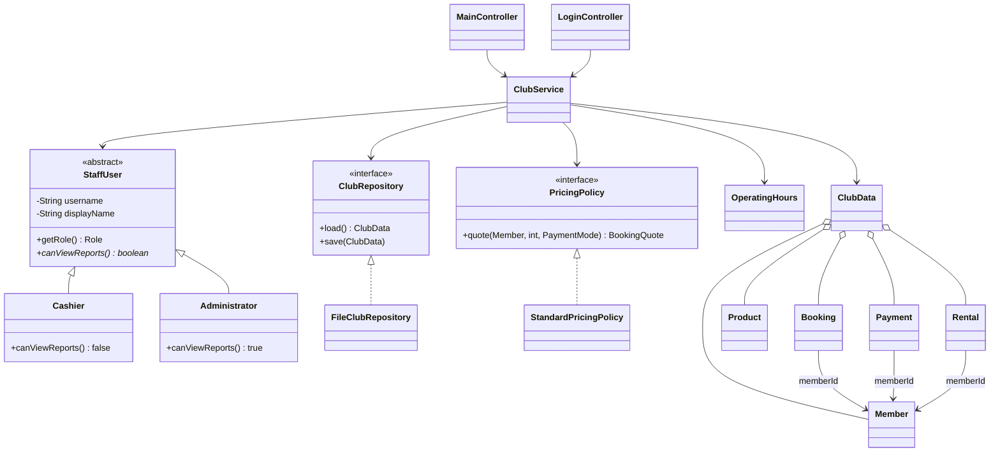

# แนวอธิบายโครงงาน OOP

## ปัญหาและวิธีแก้

พนักงานต้องจองสนามให้สมาชิกโดยหลีกเลี่ยงเวลาซ้อน คิดราคาตามชั่วโมงและสิทธิ์ บันทึกหลักฐานการจ่าย รวมถึงแยกเงินรับจากค่าเช่าสนาม แพ็กเกจ เช่าอุปกรณ์ และขายสินค้า ผู้ดูแลตรวจประวัติและรายได้ได้

## Class diagram



## ตัวอย่าง Polymorphism ที่ใช้จริง

```java
StaffUser staff = new Cashier("cashier", "แคชเชียร์");
System.out.println(staff.canViewReports()); // false
staff = new Administrator("admin", "ผู้ดูแลระบบ");
System.out.println(staff.canViewReports()); // true

PricingPolicy pricing = new StandardPricingPolicy();
ClubRepository repository = new FileClubRepository(dataDirectory);
ClubService club = new ClubService(repository, pricing, dataDirectory, clock);
```

`ClubService` ไม่ขึ้นกับคลาสเก็บไฟล์โดยตรง สามารถเขียน `DatabaseClubRepository implements ClubRepository` แล้วแทนที่ได้ การทดสอบใช้ repository ที่จำลองเขียนไฟล์ล้มเหลว เพื่อตรวจว่าไม่หักชั่วโมงหรือบันทึกการจองบางส่วน

## ลำดับการจอง

1. Controller รับสมาชิก สนาม วันที่ เวลา จำนวนชั่วโมง วิธีชำระ และสลิป
2. Service ตรวจเข้าสู่ระบบ สมาชิก เวลาในอนาคต เวลาเปิด สนาม 1-12 และรายการที่เวลาทับกัน
3. `PricingPolicy` คำนวณค่าเช่า ชั่วโมงแพ็กเกจที่ต้องใช้ และจำนวนชั่วโมงลดราคา
4. คัดลอกสลิปไป `data/receipts` ด้วยชื่อไม่ซ้ำ
5. สร้างสำเนาข้อมูล เพิ่มการจอง เปลี่ยนยอดสมาชิก และเพิ่มรายรับเฉพาะเงินที่รับจริง
6. Repository บันทึกไฟล์สำเนาให้สำเร็จก่อน Service จึงเปลี่ยนข้อมูลปัจจุบัน
7. Controller รีเฟรชตาราง ยอดสมาชิก และสถานะสนาม

## ตัวอย่างการคำนวณ

| เงื่อนไข | จองเพิ่ม | ชำระเงิน | ตัดแพ็กเกจ |
|---|---:|---:|---:|
| สะสม 0 ชั่วโมง จ่ายปกติ | 2 ชม. | 360 บาท | 0 |
| สะสม 19 ชั่วโมง จ่ายปกติ | 1 ชม. | 54 บาท | 0 |
| สะสม 18 ชั่วโมง จ่ายปกติ | 3 ชม. | 180 + 54 + 180 = 414 บาท | 0 |
| สะสม 5 ชั่วโมง แพ็กเกจเหลือ 15 | 2 ชม. | 0 บาท | 2 |
| สะสม 19 ชั่วโมง แพ็กเกจเหลือ 15 | 2 ชม. | 54 บาท | 1 |

## แนวทางสาธิตส่งงาน

1. เข้าบัญชีแคชเชียร์ สมัครสมาชิก แล้วลองสมัครเบอร์เดิมให้เห็น validation
2. ซื้อแพ็กเกจโดยแนบสลิป แล้วจอง 2 ชั่วโมงด้วยแพ็กเกจให้เห็นยอดลดจาก 15 เป็น 13
3. ลองจองสนามเดิมในช่วงซ้อน ให้เห็นการป้องกันและสถานะไม่ว่าง
4. ทดลองวันเสาร์/อาทิตย์ให้เห็นเวลา 10:00–20:00
5. เช่ารองเท้า 1 คู่และขายเทปพันด้าม 2 ชิ้น สังเกตยอดและสต็อก
6. ออกจากระบบ เข้าบัญชีผู้ดูแล ดูประวัติและรายได้ แพ็กเกจมีรายรับ 2,600 บาทเพียงครั้งเดียว
7. เปิด `StaffUser`, `Cashier`, `Administrator`, `PricingPolicy` และ `ClubRepository` อธิบาย inheritance, abstraction, polymorphism และ interface
8. ปิดแล้วเปิดโปรแกรมใหม่ แสดงว่าข้อมูลและสำเนาสลิปยังอยู่

ควรอ่านโค้ดและปรับชื่อ/รูปแบบตามที่อาจารย์กำหนด พร้อมอธิบายกติกาที่เลือกใช้จาก README ได้ด้วยตนเอง
